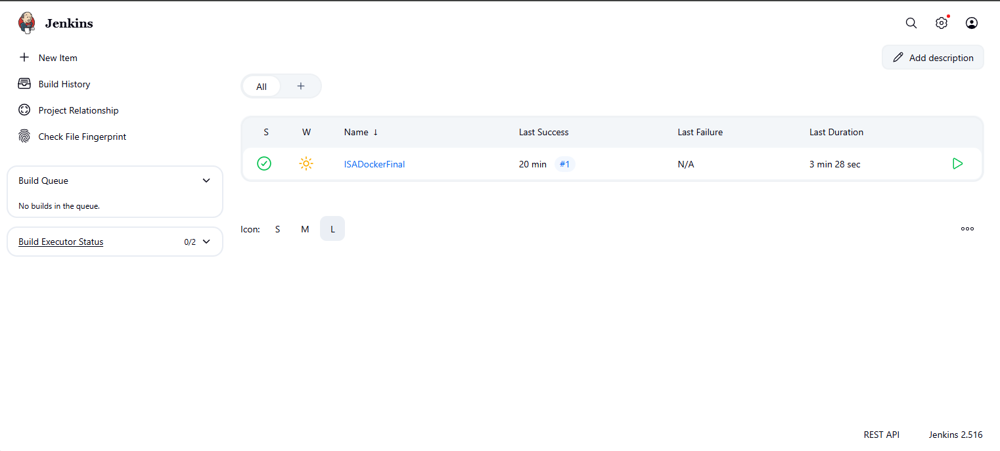
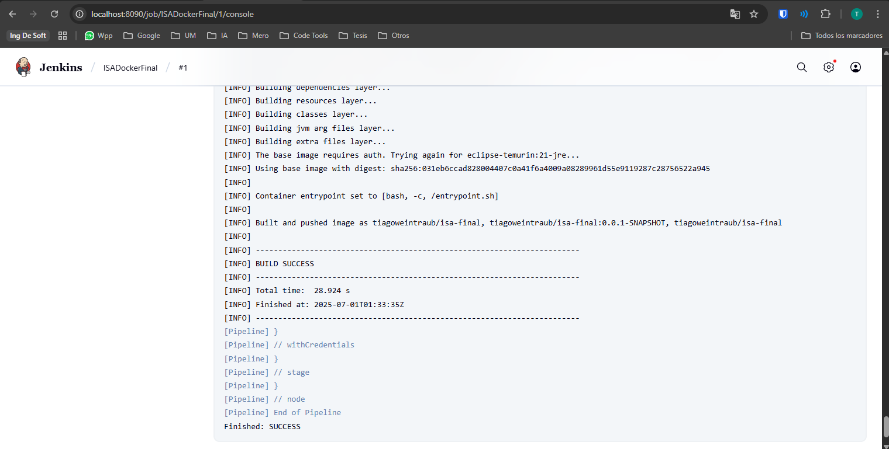

# Expenses: JHipster App with CI/CD and ELK Logging

Expense-tracking web app (Spring Boot + Angular) with Docker, a Jenkins CI/CD pipeline and centralized logging on the ELK stack.  
Aplicación web de registro de gastos (Spring Boot + Angular) con Docker, pipeline CI/CD en Jenkins y logging centralizado con ELK.


[English](#english) · [Español](#español)

## English

### About
Final project for **Ingeniería de Software Aplicada** (Applied Software Engineering) at Universidad de Mendoza, Argentina (2025). The application was generated with JHipster 7.9.3 from a JDL model ([`expenses.jdl`](expenses.jdl)), then extended with the delivery and quality tooling around it: custom unit and E2E tests, a Docker Compose stack with MySQL and ELK, JSON log shipping to Logstash, and a Jenkins pipeline that builds the app and pushes its Docker image to Docker Hub.

### Features
- **Expenses CRUD**: description (required, max 200 chars), amount and date. REST API under `/api/expenses` (paginated list, get, create, update, partial update, delete) plus Angular list, detail, create/edit and delete screens.
- **JWT authentication**: login, registration, account activation and password reset. `/api/admin/**` is restricted to admins; the rest of `/api/**` requires a valid token.
- **Admin UI**: user management, metrics, health, configuration, log levels and Swagger API docs.
- **Versioned schema**: Liquibase changelogs, with sample data loaded in the `dev` profile.
- **Centralized logging**: JSON logs over TCP to Logstash, tagged by `log_type` (application / framework / database / system) and indexed daily in Elasticsearch (`expenses-logs-YYYY.MM.dd`), viewable in Kibana.
- **Containerized delivery**: Dockerfile, Docker Compose stack with healthchecks, and a Jib-built image published by Jenkins.

### Tech stack
| Area | Technologies |
|---|---|
| Backend | Java 17, Spring Boot 2.7 (Web, Security, Data JPA), JWT, MapStruct, Ehcache, Liquibase, springdoc |
| Frontend | Angular 14, TypeScript, Bootstrap 5 |
| Database | MySQL 8 (prod / Docker), H2 (dev) |
| DevOps | Maven Wrapper, Docker, Docker Compose, Jib, Jenkins |
| Observability | Logback Logstash appender, Logstash, Elasticsearch, Kibana 7.17 |
| Testing & quality | JUnit 5, Mockito, AssertJ, ArchUnit, Testcontainers, Jest, Cypress, Checkstyle (nohttp), SonarQube |

### Architecture / Project structure
```
Angular SPA ──JWT──> REST API (/api/expenses) ──> ExpensesService (DTO <-> entity, MapStruct) ──> JPA ──> MySQL / H2
Logback (JSON over TCP) ──> Logstash :5044 ──> Elasticsearch :9200 ──> Kibana :5601
```
```
├── expenses.jdl                     # JDL domain model (entity, DTO, service, pagination)
├── src/main/java/.../expenses/      # Spring Boot: domain, repository, service, web/rest, security/jwt
├── src/main/webapp/app/             # Angular SPA (entities/expenses, admin, account)
├── src/main/resources/              # Spring profiles, Liquibase changelogs, logback-spring-elk.xml
├── src/main/docker/logstash/        # Logstash settings and pipeline
├── src/test/                        # JUnit tests (incl. ExpensesServiceTest) and Cypress specs
├── scripts/test-logging.sh          # End-to-end logging check (API -> Elasticsearch)
├── Dockerfile, docker-compose.yml   # App image and full stack (app, MySQL, ELK)
├── Jenkinsfile, jenkins-arm/        # CI/CD pipeline and a Jenkins + JDK 17 image for ARM hosts
└── sonar-project.properties         # SonarQube analysis settings
```
**CI/CD pipeline (`Jenkinsfile`)**: `checkout` → `check java` → `clean` → `nohttp` (Checkstyle) → `install tools` and `npm install` (Node via `frontend-maven-plugin`) → `backend tests` / `frontend tests` (stages present, commands commented out) → `packaging` (`./mvnw verify -Pprod -DskipTests`, archives the JAR) → `publish docker` (`./mvnw jib:build` with the Jenkins credential `dockerhub-login-final`, pushes `tiagoweintraub/isa-final`).

The pipeline was first tried on macOS (Apple Silicon), including the custom image in `jenkins-arm/`, and was finally run on Windows with the official `jenkins/jenkins` image:

 

### Getting started
**Prerequisites:** Java 17 and Docker. Node.js is optional: the Maven build downloads Node 16.17 / npm 8.19 locally (`./npmw` wraps them).

**Local development (H2 database)**
```bash
./mvnw       # builds the Angular app and starts Spring Boot (dev profile) on http://localhost:8080
npm start    # optional: Angular dev server with live reload on http://localhost:9000
```
Default JHipster users: `admin` / `admin` and `user` / `user`.

**Full stack with Docker Compose (app + MySQL + ELK)**
```bash
./mvnw clean package -DskipTests   # builds target/expenses-0.0.1-SNAPSHOT.jar
docker build -t expenses:latest .
docker compose up                  # app :8080, MySQL :3306, Elasticsearch :9200, Logstash :5044, Kibana :5601
docker compose down
```
In Compose the app runs with the `prod,api-docs` profiles and sends its logs to Logstash. To check the logging pipeline end to end (needs `curl` and `jq`), run the script below, then open Kibana at http://localhost:5601.
```bash
bash scripts/test-logging.sh       # creates an expense via the API, then queries expenses-logs-* in Elasticsearch
```
**Published image** (pushed by the Jenkins pipeline, `linux/amd64`). It is built with the `prod` profile, so it needs a reachable MySQL database: point `SPRING_DATASOURCE_URL` at it, or swap `expenses:latest` for this image in `docker-compose.yml`.
```bash
docker pull tiagoweintraub/isa-final:latest
docker run -p 8080:8080 \
  -e SPRING_DATASOURCE_URL='jdbc:mysql://<host>:3306/expenses?createDatabaseIfNotExist=true' \
  tiagoweintraub/isa-final:latest
```

### Tests
```bash
./mvnw test -Dtest=ExpensesServiceTest   # custom service unit tests (Mockito)
./mvnw verify                            # full backend suite: unit + integration tests
npm test                                 # Jest tests for the Angular app (runs ESLint first)
npx cypress open                         # Cypress, interactive mode
npm run e2e:headless -- --spec "src/test/javascript/cypress/e2e/expenses-e2e-custom.cy.ts"
```
- **`ExpensesServiceTest`**: saves a valid expense (checks the mapper → repository → mapper calls) and rejects a null or empty description: the `ConstraintViolationException` is propagated and no DTO is returned. Run a single case with `./mvnw test -Dtest=ExpensesServiceTest#shouldNotSaveExpenseWhenDescriptionIsNull`.
- **`expenses-e2e-custom.cy.ts`**: logs in as admin, creates an expense through the form (expects `201`), deletes one from the list (expects `204`) and runs the full login → create → delete flow, removing any data it created.
- Cypress expects the app on `http://localhost:8080`; `e2e:headless` waits for `/management/health` and runs in Chrome.
- Integration tests use an embedded database by default; with `-Pprod` they run against a MySQL Testcontainer (needs Docker).
- The JHipster-generated suites are kept as well: REST integration tests, ArchUnit layer checks, Jest component specs and Cypress account/admin/entity specs.
- **SonarQube**: `docker compose -f src/main/docker/sonar.yml up -d`, then `./mvnw -Pprod clean verify sonar:sonar` (dashboard on http://localhost:9001).

### Author
**Tiago Weintraub**: [github.com/TiagoWeintraub](https://github.com/TiagoWeintraub)

## Español

### Sobre el proyecto
Proyecto final de **Ingeniería de Software Aplicada** en la Universidad de Mendoza, Argentina (2025). La aplicación se generó con JHipster 7.9.3 a partir de un modelo JDL ([`expenses.jdl`](expenses.jdl)) y después se le sumó el tooling de entrega y calidad: tests unitarios y E2E propios, un stack de Docker Compose con MySQL y ELK, envío de logs en JSON a Logstash y un pipeline de Jenkins que compila la app y publica su imagen Docker en Docker Hub.

### Funcionalidades
- **CRUD de gastos**: descripción (obligatoria, máx. 200 caracteres), monto y fecha. API REST en `/api/expenses` (listado paginado, consulta, alta, modificación, modificación parcial, baja) y pantallas Angular de listado, detalle, alta/edición y baja.
- **Autenticación JWT**: login, registro, activación de cuenta y reseteo de contraseña. `/api/admin/**` es solo para administradores; el resto de `/api/**` requiere un token válido.
- **UI de administración**: gestión de usuarios, métricas, health, configuración, niveles de log y documentación Swagger de la API.
- **Esquema versionado**: changelogs de Liquibase, con datos de ejemplo en el perfil `dev`.
- **Logging centralizado**: logs JSON por TCP a Logstash, etiquetados con `log_type` (application / framework / database / system) e indexados por día en Elasticsearch (`expenses-logs-YYYY.MM.dd`), visibles en Kibana.
- **Entrega en contenedores**: Dockerfile, stack de Docker Compose con healthchecks e imagen construida con Jib y publicada por Jenkins.

### Tecnologías
| Área | Tecnologías |
|---|---|
| Backend | Java 17, Spring Boot 2.7 (Web, Security, Data JPA), JWT, MapStruct, Ehcache, Liquibase, springdoc |
| Frontend | Angular 14, TypeScript, Bootstrap 5 |
| Base de datos | MySQL 8 (prod / Docker), H2 (dev) |
| DevOps | Maven Wrapper, Docker, Docker Compose, Jib, Jenkins |
| Observabilidad | Appender Logstash de Logback, Logstash, Elasticsearch, Kibana 7.17 |
| Testing y calidad | JUnit 5, Mockito, AssertJ, ArchUnit, Testcontainers, Jest, Cypress, Checkstyle (nohttp), SonarQube |

### Arquitectura / Estructura
```
Angular SPA ──JWT──> REST API (/api/expenses) ──> ExpensesService (DTO <-> entity, MapStruct) ──> JPA ──> MySQL / H2
Logback (JSON over TCP) ──> Logstash :5044 ──> Elasticsearch :9200 ──> Kibana :5601
```
```
├── expenses.jdl                     # JDL domain model (entity, DTO, service, pagination)
├── src/main/java/.../expenses/      # Spring Boot: domain, repository, service, web/rest, security/jwt
├── src/main/webapp/app/             # Angular SPA (entities/expenses, admin, account)
├── src/main/resources/              # Spring profiles, Liquibase changelogs, logback-spring-elk.xml
├── src/main/docker/logstash/        # Logstash settings and pipeline
├── src/test/                        # JUnit tests (incl. ExpensesServiceTest) and Cypress specs
├── scripts/test-logging.sh          # End-to-end logging check (API -> Elasticsearch)
├── Dockerfile, docker-compose.yml   # App image and full stack (app, MySQL, ELK)
├── Jenkinsfile, jenkins-arm/        # CI/CD pipeline and a Jenkins + JDK 17 image for ARM hosts
└── sonar-project.properties         # SonarQube analysis settings
```
**Pipeline CI/CD (`Jenkinsfile`)**: `checkout` → `check java` → `clean` → `nohttp` (Checkstyle) → `install tools` y `npm install` (Node vía `frontend-maven-plugin`) → `backend tests` / `frontend tests` (etapas presentes, comandos comentados) → `packaging` (`./mvnw verify -Pprod -DskipTests`, archiva el JAR) → `publish docker` (`./mvnw jib:build` con la credencial de Jenkins `dockerhub-login-final`, publica `tiagoweintraub/isa-final`).

El pipeline se probó primero en macOS (Apple Silicon), incluida la imagen propia de `jenkins-arm/`, y finalmente se ejecutó en Windows con la imagen oficial `jenkins/jenkins`:

 

### Cómo usarlo
**Requisitos:** Java 17 y Docker. Node.js es opcional: el build de Maven descarga Node 16.17 / npm 8.19 localmente (`./npmw` los envuelve).

**Desarrollo local (base H2)**
```bash
./mvnw       # builds the Angular app and starts Spring Boot (dev profile) on http://localhost:8080
npm start    # optional: Angular dev server with live reload on http://localhost:9000
```
Usuarios por defecto de JHipster: `admin` / `admin` y `user` / `user`.

**Stack completo con Docker Compose (app + MySQL + ELK)**
```bash
./mvnw clean package -DskipTests   # builds target/expenses-0.0.1-SNAPSHOT.jar
docker build -t expenses:latest .
docker compose up                  # app :8080, MySQL :3306, Elasticsearch :9200, Logstash :5044, Kibana :5601
docker compose down
```
En Compose la app corre con los perfiles `prod,api-docs` y envía sus logs a Logstash. Para verificar el pipeline de logging de punta a punta (requiere `curl` y `jq`), correr el script y después abrir Kibana en http://localhost:5601.
```bash
bash scripts/test-logging.sh       # creates an expense via the API, then queries expenses-logs-* in Elasticsearch
```
**Imagen publicada** (subida por el pipeline de Jenkins, `linux/amd64`). Se construye con el perfil `prod`, así que necesita una base MySQL accesible: apuntá `SPRING_DATASOURCE_URL` a ella, o reemplazá `expenses:latest` por esta imagen en `docker-compose.yml`.
```bash
docker pull tiagoweintraub/isa-final:latest
docker run -p 8080:8080 \
  -e SPRING_DATASOURCE_URL='jdbc:mysql://<host>:3306/expenses?createDatabaseIfNotExist=true' \
  tiagoweintraub/isa-final:latest
```

### Tests
```bash
./mvnw test -Dtest=ExpensesServiceTest   # custom service unit tests (Mockito)
./mvnw verify                            # full backend suite: unit + integration tests
npm test                                 # Jest tests for the Angular app (runs ESLint first)
npx cypress open                         # Cypress, interactive mode
npm run e2e:headless -- --spec "src/test/javascript/cypress/e2e/expenses-e2e-custom.cy.ts"
```
- **`ExpensesServiceTest`**: guarda un gasto válido (verifica las llamadas mapper → repository → mapper) y rechaza una descripción nula o vacía: la `ConstraintViolationException` se propaga y no se devuelve ningún DTO. Para un caso puntual: `./mvnw test -Dtest=ExpensesServiceTest#shouldNotSaveExpenseWhenDescriptionIsNull`.
- **`expenses-e2e-custom.cy.ts`**: hace login como admin, crea un gasto desde el formulario (espera `201`), elimina uno desde el listado (espera `204`) y recorre el flujo completo login → alta → baja, limpiando los datos que crea.
- Cypress espera la app en `http://localhost:8080`; `e2e:headless` espera a `/management/health` y corre en Chrome.
- Los tests de integración usan una base embebida por defecto; con `-Pprod` corren contra un Testcontainer de MySQL (requiere Docker).
- Se conservan también los tests generados por JHipster: integración de la API REST, reglas de capas con ArchUnit, specs de componentes con Jest y specs de Cypress de cuenta, administración y entidad.
- **SonarQube**: `docker compose -f src/main/docker/sonar.yml up -d` y luego `./mvnw -Pprod clean verify sonar:sonar` (dashboard en http://localhost:9001).

### Autor
**Tiago Weintraub**: [github.com/TiagoWeintraub](https://github.com/TiagoWeintraub)
